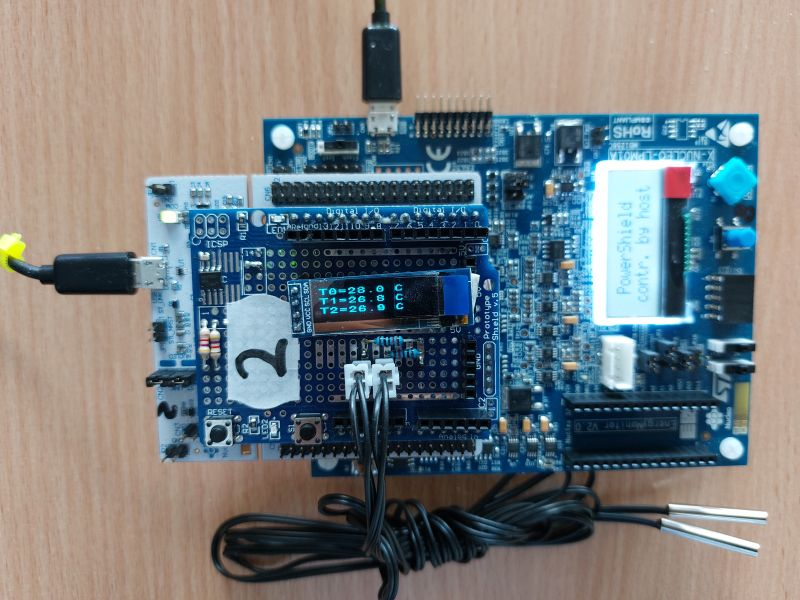
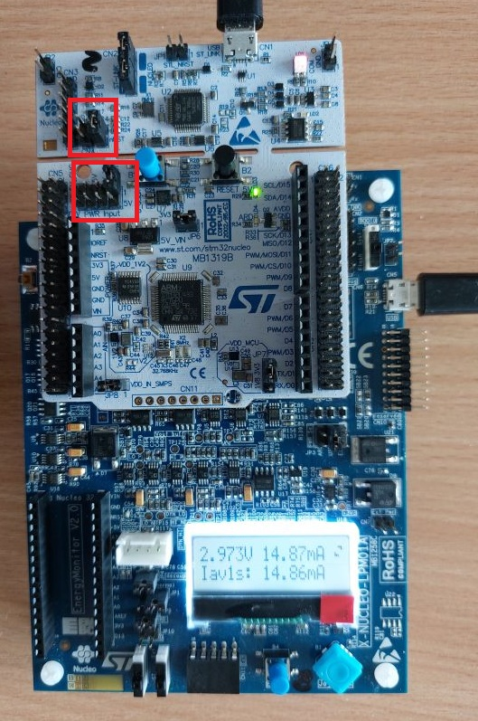

# Assembly guide

The laboratory setup is a three-level stack (photo below): the **X-NUCLEO-LPM01A** power measurement board at the bottom, the **NUCLEO-L433RC-P** target board in the middle, and the **sensor/display add-on board** on top. The add-on board is built on an Arduino Uno prototype shield; its circuit is in `../schematics/addon_board/` and its parts in `../bom/`.

## 1. Build the add-on board

All components are through-hole except the I2C sensor (SO-8 or breakout module). Solder them on the prototype shield according to the schematic:

| Function | Components | Connection to the Nucleo |
|---|---|---|
| I2C bus | R1, R2 4.7 kΩ pull-ups to VCC | PC0 = SCL, PC1 = SDA (I2C3) |
| Digital sensor | IC2 (LM75 / MAX7500, A2..A0 to GND; or BMP180/BMP280 module) | I2C3 |
| OLED display | 1×4 socket for the 0.91" SSD1306 module | VCC from PA12 (OLED_VCC), SCL, SDA, GND |
| Analog sensor 1 | R5 from the excitation node to PC2, R7 (NTC or photoresistor) from PC2 to GND | PC2 (ADC_R5) |
| Analog sensor 2 | R6 from the excitation node to PC3, R8 (NTC or photoresistor) from PC3 to GND | PC3 (ADC_R6) |
| Divider excitation | Common node of R5 and R6 | PA0 drives it (ADC_DRIVE), PA1 measures it |
| LEDs | VCC – R4 (100 Ω) – D1 – PA9; VCC – R3 (100 Ω) – D2 – PA10 | PA9, PA10 (active low) |
| Push button | S1 from PA11 to GND | PA11 |

Fit the values of the board variant (`../bom/board_variants.csv`). On NTC variants the probes are plugged into 2-pin JST XH headers (J2). Wire the OLED socket in the pin order printed on the display module. Solder the stacking headers last, so the shield plugs onto the Nucleo Arduino connectors.

Before first use, check with a multimeter that VCC and GND are not shorted, and that each divider measures the expected resistance between the excitation node and GND.

## 2. Configure the Nucleo board

For current measurement the Nucleo is supplied by the X-NUCLEO-LPM01A, not by its own USB port:

- **JP4 (nRST):** fitted.
- **JP5 (power input):** all jumpers removed.

Without the power measurement board, fit JP5 in position **5V_STL** to supply the board from the ST-LINK USB port.

## 3. Stack and connect

1. Plug the NUCLEO-L433RC-P onto the X-NUCLEO-LPM01A, then the add-on board onto the NUCLEO-L433RC-P.
2. Connect the Nucleo ST-LINK micro-USB port to the PC (programming and debugging from Keil MDK).
3. Connect the X-NUCLEO-LPM01A micro-USB port (CN5) to the PC (current measurement with STM32CubeMonitor-Power).
4. In STM32CubeMonitor-Power, select the board's COM port and click **TAKE CONTROL**; the target is then powered from the measurement board. Without the software, power is switched on with the blue **Enter** button of the X-NUCLEO-LPM01A when its display shows "Supply stopped, Start: enter".

Programming and measurement use separate USB connections, so nothing has to be reconnected between debugging and measurement.

## 4. Function check

After the template firmware is loaded, the OLED shows the start-up text and then the sensor readings (T0, T1, T2), updated once per averaging period. In STM32CubeMonitor-Power the current profile shows short active-mode peaks for each sensor reading and a longer peak for each display update (see the example waveform in the laboratory handout).
